<p align="center"></p>

# scibox

scibox is a toolbox for engineers and scientists.
It contains a unit converter, an engineering formula solver, a graph plotter, and a scientific calculator.

scibox has two applications with the same functions:

- **scibox-gui**: a desktop window (egui and wgpu). The graphs have smooth, anti-aliased lines.
- **scibox-tui**: a terminal application (ratatui). It works with the keyboard and the mouse, also through SSH.

## scibox-gui

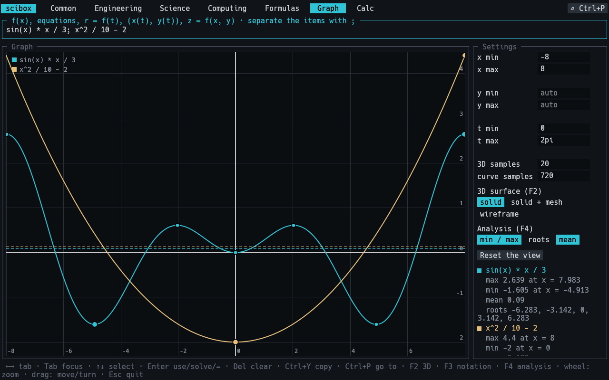

| 3D graph | Formulas |
| --- | --- |
| 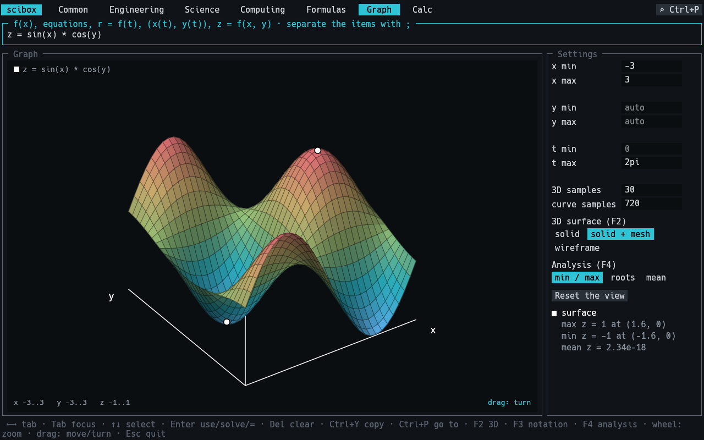 | 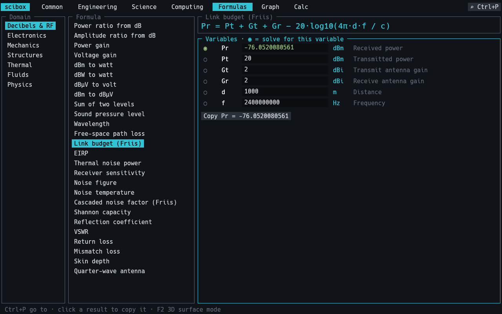 |
| **Converter** | **Calculator** |
| 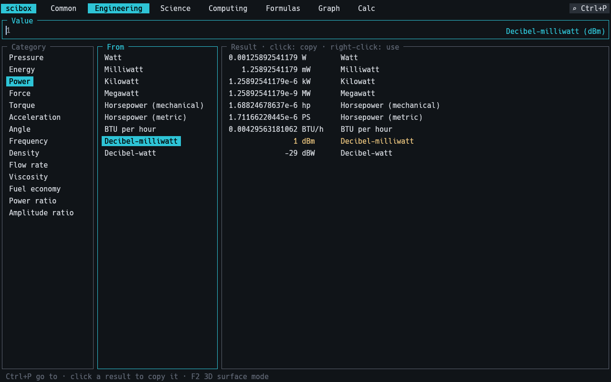 | 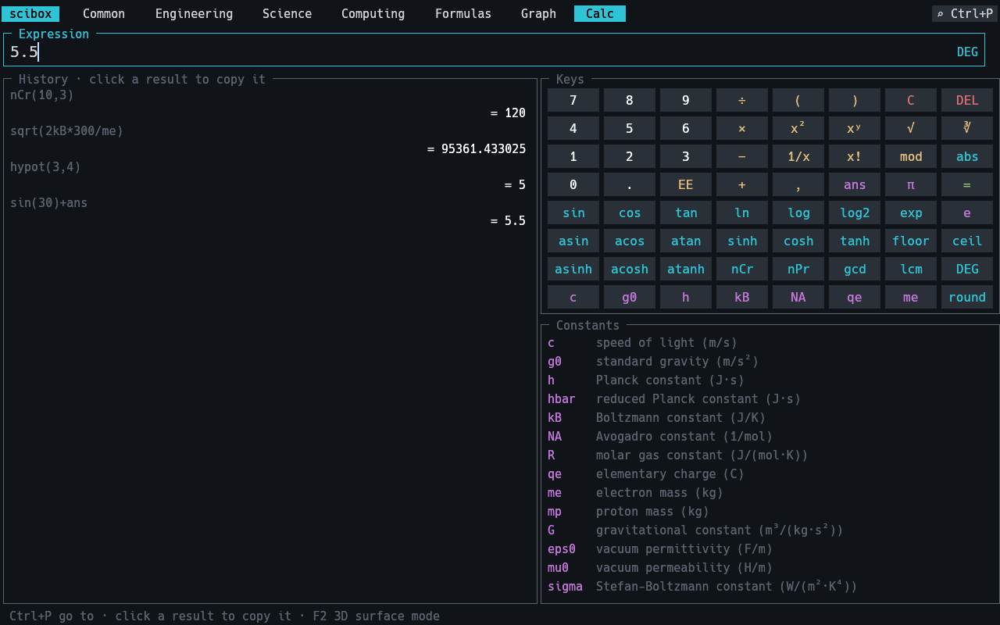 |

## scibox-tui

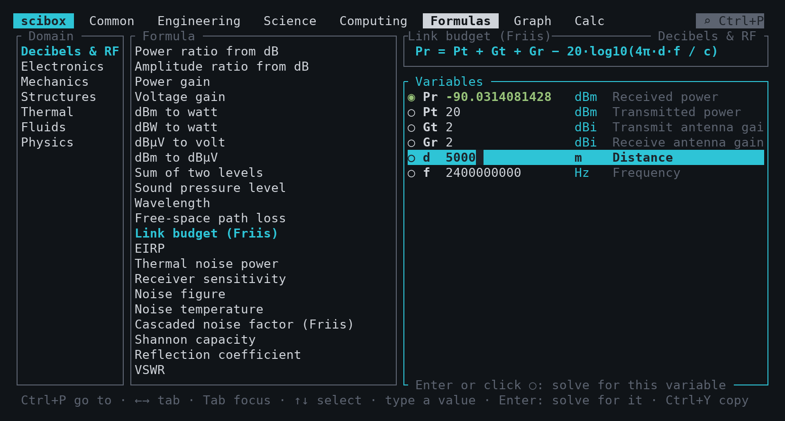

| Graph | 3D graph |
| --- | --- |
| 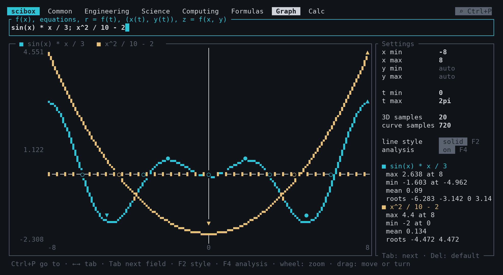 | 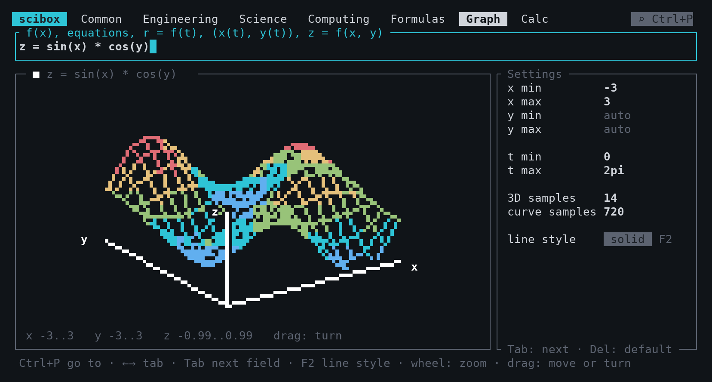 |
| **Polar and parametric curves** | **Converter** |
| 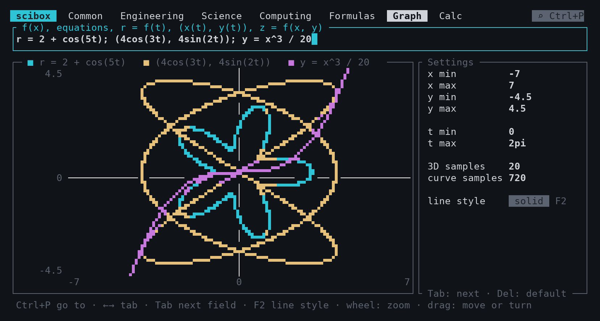 |  |
| **Calculator** | **Go to (Ctrl+P)** |
| 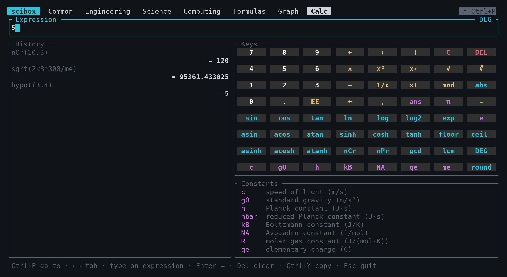 | 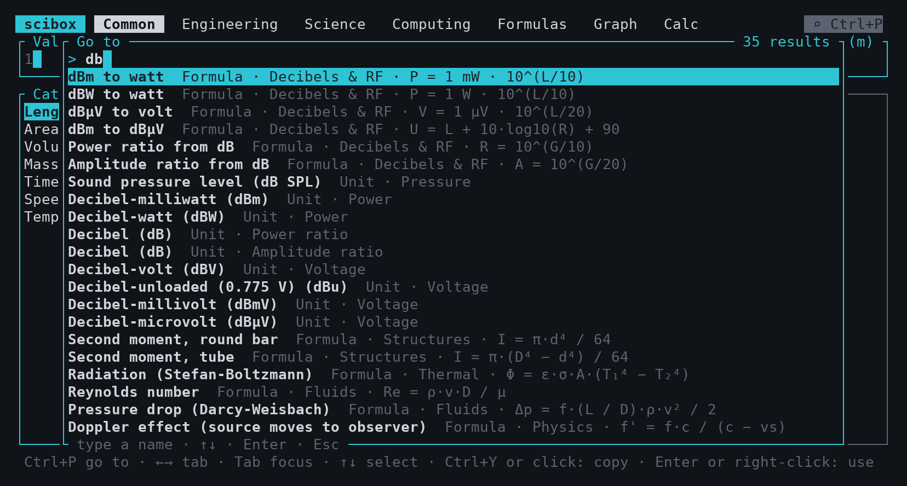 |

## Features

- **Unit converter**: 400 units in 49 categories, in 4 tabs (Common, Engineering, Science, Computing).
  One input value shows the result in all the units of the category.
- **Logarithmic units**: dBm, dBW, dBV, dBu, dBµV, dB SPL, and the power and amplitude ratios (dB, B, Np).
- **Number base**: decimal, hexadecimal, binary, and octal (128-bit integers).
- **Formulas**: more than 240 formulas in 9 domains (Decibels & RF, Electronics, Mechanics, Structures, Thermal, Fluids, Physics, Chemistry, Optics).
  You can solve each formula for any variable.
- **Graph**: plot functions, equations in x and y, polar curves, parametric curves, and 3D surfaces. Show the extrema, the roots, and the mean values.
- **Calculator**: a scientific calculator with a keypad that you can click.
- **Powers of 10**: the results show as `1.26×10⁻⁶`. Press F3 to select the notation: auto, scientific, or engineering (the exponent is a multiple of 3, as the SI prefixes).
- **Go to**: press Ctrl+P and type a part of a name to go to a category, a unit, or a formula.
- **Copy**: copy a result to the clipboard with a mouse click (or Ctrl+Y in the TUI).
- All the input fields accept expressions, for example `3*12.5`, `2pi`, or `4.7e3`.

## Install

You must have the Rust toolchain (`cargo`).

```sh
cargo install --git https://github.com/polymood/scibox scibox-gui
cargo install --git https://github.com/polymood/scibox scibox-tui
```

To build from the source code:

```sh
git clone https://github.com/polymood/scibox
cd scibox
cargo run --release -p scibox-gui
cargo run --release -p scibox-tui
```

On Linux, scibox-gui needs the X11 or Wayland libraries of your desktop (for example `libxkbcommon-x11-0`).

### Windows and WSL

To make a Windows executable from Linux or WSL, install the `x86_64-pc-windows-gnu` target and MinGW-w64:

```sh
rustup target add x86_64-pc-windows-gnu
cargo build --release -p scibox-gui --target x86_64-pc-windows-gnu
```

The file is `target/x86_64-pc-windows-gnu/release/scibox-gui.exe`. In WSL, this executable uses the real GPU.
If you run the Linux version in WSL and the window does not open, use X11: `WAYLAND_DISPLAY= scibox-gui`.

## Use

The two applications have the same tabs and the same functions.
In scibox-gui, use the mouse as in a usual desktop application. The keys in this section are for scibox-tui.

### General keys (scibox-tui)

| Key | Action |
| --- | --- |
| Ctrl+P, Ctrl+K | Open the "Go to" window |
| Left, Right | Go to the previous or the next tab |
| Tab, Shift+Tab | Move the focus to the next or the previous pane |
| Up, Down | Select an item in the pane that has the focus |
| Backspace | Delete the last character |
| Delete | Clear the input |
| Ctrl+Y | Copy the current result (as `1.26e-6`, a valid input for other programs) |
| F3 | Select the notation of the results: auto, scientific, or engineering |
| Esc, Ctrl+C | Quit (Esc closes the "Go to" window first) |

You can also click the tabs, the lists, and the `⌕ Ctrl+P` button.
Turn the mouse wheel to scroll a list.

### Converter tabs

1. Select a category and the "From" unit.
2. Type the value. An empty input has the value 1.
3. Read the results in the "Result" pane.

To copy a result, click it. To use a result as the new input, right-click it, or select it and press Enter.

### Formulas tab

The formula box shows the equation in mathematical notation (fractions, roots, exponents, subscripts).
scibox converts the equation to LaTeX. scibox-gui typesets it with the STIX Two Math font (latex-rust).
scibox-tui draws it with Unicode characters (term-maths).

The green radio button (◉) shows the variable that scibox calculates.

1. Select a domain and a formula.
2. Select a variable and type its value. The result changes immediately.
3. To calculate a different variable, select it and press Enter, or click its radio button (○).

If you type a value in the result row, scibox calculates the variable that you did not change for the longest time.
A numerical solver finds the variable. Thus, all the forms of a formula are available.
For example, the formula "dBm to watt" also converts watts to dBm.

### Graph tab

1. Type one or more items. Use `;` between the items.
2. Set the ranges and the samples in the "Settings" sidebar (see the table below).

| Item | Examples |
| --- | --- |
| Function | `sin(x)`, `y = x^3 / 20` |
| Equation in x and y | `x = 2`, `x^2 + y^2 = 9`, `y^2 = x^3 - x` |
| Polar curve | `r = 2 + cos(5t)` |
| Parametric curve | `(4cos(3t), 4sin(2t))` |
| 3D surface | `z = sin(x) * cos(y)` |

| Setting | Function | Default |
| --- | --- | --- |
| x min, x max | The x range. For a 3D surface, the x range of the grid. | -10, 10 |
| y min, y max | The y range. If a field is empty, scibox calculates the range. | auto |
| t min, t max | The range of t for the polar and parametric curves. | 0, 2pi |
| 3D samples | The number of grid points on each axis of a 3D surface (2 to 200). | 20 |
| curve samples | The number of points on a polar or parametric curve (10 to 100000). | 720 |
| line style (TUI, 2D) | Click it or press F2 to change it. | solid |
| 3D surface | Click it or press F2 to change it: solid, solid + mesh (GUI only), or wireframe. | solid |

Press Tab to go to the next setting. Press Delete to clear a setting and use its default value.
All the settings accept expressions, for example `2pi`.

#### Analysis

Press F4 to show or hide the analysis of the functions:

- **min / max**: the global minimum and maximum, and the local extrema.
- **roots**: the points where the function crosses zero.
- **mean**: the mean value of the function on the x range (a dashed line).

For a 3D surface, the analysis shows the highest point, the lowest point, and the mean value of z.
The graph shows markers only. The sidebar lists all the values. In scibox-gui, you can show each item separately.
In scibox-gui, the sidebar also shows the value of each function at the x position of the mouse pointer.

Turn the mouse wheel on the graph to zoom. Drag the graph to move it.
For a 3D surface, drag the graph to turn the view.
In the solid mode, scibox draws the cells of the surface from the farthest to the nearest.
Thus, a near cell hides the cells behind it. The light comes from the top left, and the color shows the height.
The trigonometric functions of the graph use radians.

Press F2 to change the line style:

- **solid**: octant characters (2 × 4 pixels in each cell, no gaps).
- **dots**: braille characters.
- **blocks**: quadrant characters.
- **half blocks**: the half block characters.

The solid style needs a font with the octant characters of Unicode 16 (for example, a recent Cascadia Code in Windows Terminal).
If you see empty boxes, press F2 to select a different style.

### Calculator tab

The keypad has 64 keys of a fixed size: digits, operators, functions, and physical constants.
In a big window, the keys keep their size and the history gets the space.
You can also type all the functions and the constants.

| Item | Syntax |
| --- | --- |
| Operators | `+ - * / % ^ !` and parentheses (`%` is the remainder) |
| Implicit multiplication | `2pi`, `3(1+2)`, `2kB` |
| Exponent of 10 | `1.5E3` (the EE key) |
| Functions | `sin cos tan asin acos atan sinh cosh tanh asinh acosh atanh sqrt cbrt ln log log2 exp abs floor ceil round` |
| Functions of two values | `nCr(n, r)`, `nPr(n, r)`, `gcd(a, b)`, `lcm(a, b)`, `min(a, b)`, `max(a, b)`, `hypot(a, b)`, `root(x, n)` |
| Constants | `pi`, `e`, `tau`, `ans` (the last result) |
| Physical constants (SI) | `c g0 h hbar kB NA R qe me mp G eps0 mu0 sigma` |

The DEG key sets the angle unit to degrees or radians.
After a result, type a number to start a new calculation.
Type an operator to continue the calculation with the result.
The "Constants" list under the keypad gives the name and the unit of each physical constant.

### Clipboard

scibox sends the copied text to the terminal with the OSC 52 sequence.
Most terminals accept this sequence (Windows Terminal, kitty, WezTerm, iTerm2, and tmux with `set-clipboard on`).
scibox also gives the text to the first available program: `clip.exe` (WSL), `pbcopy`, `wl-copy`, `xclip`, or `xsel`.

## Project structure

| Crate | Contents |
| --- | --- |
| `crates/scibox-core` | All the logic: units, formulas, calculator, search, graph math. No drawing. |
| `crates/scibox-gui` | The desktop application (egui, eframe, wgpu). |
| `crates/scibox-tui` | The terminal application (ratatui). |

A new unit or formula in `scibox-core` is available in the two applications.

## Add a unit

All the unit data is in `crates/scibox-core/src/units.rs`.
The first unit of each category is the base unit.
The factor of a unit is the value of 1 unit in the base unit.

1. Open `crates/scibox-core/src/units.rs`.
2. Find the category.
3. Add one line to the list of units:

   ```rust
   u("Furlong", "fur", 201.168),
   ```

4. Run `cargo test`.

For units that do not have a simple factor, use these functions:

- `affine(name, symbol, factor, offset)`: base = value × factor + offset (temperature scales).
- `inverse(name, symbol, k)`: base = k / value (fuel consumption).
- `log(name, symbol, reference, k)`: base = reference × 10^(value / k) (dBm: reference 0.001 W, k 10).

To add a category, write a `const` block in `crates/scibox-core/src/units.rs` and add its name to a group in `GROUPS`.
To add a converter tab, add a new `Group` to `GROUPS`.

## Add a formula

All the formulas are in `crates/scibox-core/src/formulas.rs`.
A formula has a name, an equation text, a function, and a list of variables.
The function calculates the first variable `x[0]` from the other variables `x[1]`, `x[2]`, and so on.

1. Open `crates/scibox-core/src/formulas.rs`.
2. Find the domain.
3. Add the formula:

   ```rust
   eq("Ohm's law", "V = I·R", |x| x[1] * x[2], &[
       v("V", "Voltage", "V", 0.0),
       v("I", "Current", "A", 0.01),
       v("R", "Resistance", "Ω", 1000.0),
   ]),
   ```

   The arguments of `v` are the symbol, the name, the unit, and the default value.
4. Run `cargo test`.

You do not write the other forms of the formula. The solver calculates them.
To add a domain, write a `const` list of formulas and add it to `DOMAINS`.

## Test

```sh
cargo test
```

- The test `round_trip_all_units` converts each unit to the base unit and back.
- The test `solve_all_formulas` solves each formula for each variable.

Thus, an incorrect line in `units.rs` or in `formulas.rs` causes a test failure.

## License

MIT. Refer to the [LICENSE](LICENSE) file.
