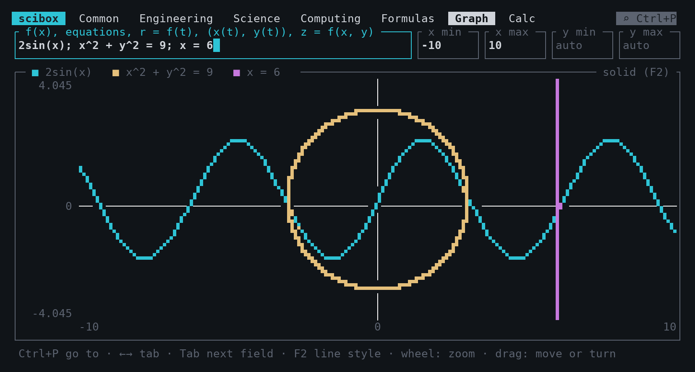
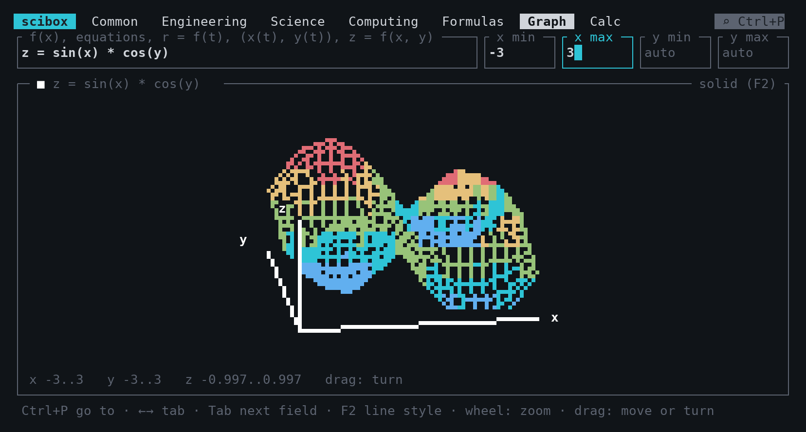
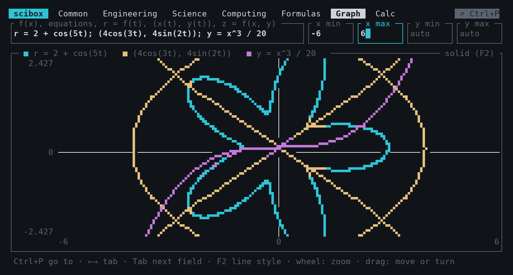
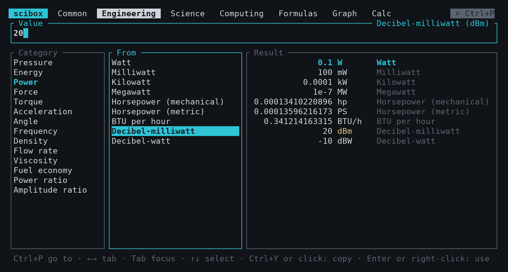
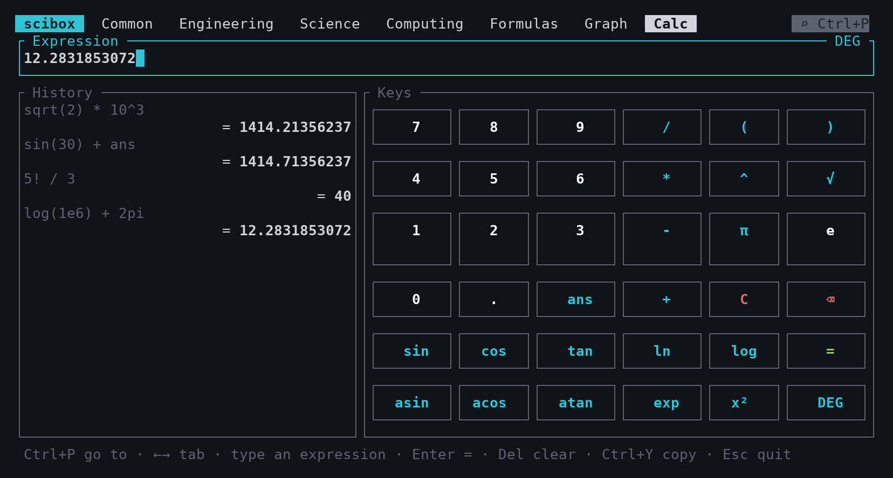

<p align="center"></p>

# scibox

scibox is a toolbox for engineers and scientists in the terminal.
It contains a unit converter, an engineering formula solver, a graph plotter, and a scientific calculator.
You can use the keyboard or the mouse.


| Graph | 3D graph |
| --- | --- |
|  |  |
| **Polar and parametric curves** | **Converter** |
|  |  |
| **Calculator** | **Go to (Ctrl+P)** |
|  |  |

## Features

- **Unit converter**: more than 30 categories in 4 tabs (Common, Engineering, Science, Computing).
  One input value shows the result in all the units of the category.
- **Logarithmic units**: dBm, dBW, dBV, dBu, dBµV, dB SPL, and the power and amplitude ratios (dB, B, Np).
- **Number base**: decimal, hexadecimal, binary, and octal (128-bit integers).
- **Formulas**: more than 130 formulas in 7 domains (Decibels & RF, Electronics, Mechanics, Structures, Thermal, Fluids, Physics).
  You can solve each formula for any variable.
- **Graph**: plot functions, equations in x and y, polar curves, parametric curves, and 3D surfaces.
- **Calculator**: a scientific calculator with a keypad that you can click.
- **Go to**: press Ctrl+P and type a part of a name to go to a category, a unit, or a formula.
- **Copy**: copy a result to the clipboard with Ctrl+Y or with a mouse click.
- All the input fields accept expressions, for example `3*12.5`, `2pi`, or `4.7e3`.

## Install

You must have the Rust toolchain (`cargo`).

```sh
cargo install --git https://github.com/polymood/scibox
```

To build from the source code:

```sh
git clone https://github.com/polymood/scibox
cd scibox
cargo run --release
```

## Use

### General keys

| Key | Action |
| --- | --- |
| Ctrl+P, Ctrl+K | Open the "Go to" window |
| Left, Right | Go to the previous or the next tab |
| Tab, Shift+Tab | Move the focus to the next or the previous pane |
| Up, Down | Select an item in the pane that has the focus |
| Backspace | Delete the last character |
| Delete | Clear the input |
| Ctrl+Y | Copy the current result |
| Esc, Ctrl+C | Quit (Esc closes the "Go to" window first) |

You can also click the tabs, the lists, and the `⌕ Ctrl+P` button.
Turn the mouse wheel to scroll a list.

### Converter tabs

1. Select a category and the "From" unit.
2. Type the value. An empty input has the value 1.
3. Read the results in the "Result" pane.

To copy a result, click it. To use a result as the new input, right-click it, or select it and press Enter.

### Formulas tab

The green radio button (◉) shows the variable that scibox calculates.

1. Select a domain and a formula.
2. Select a variable and type its value. The result changes immediately.
3. To calculate a different variable, select it and press Enter, or click its radio button (○).

If you type a value in the result row, scibox calculates the variable that you did not change for the longest time.
A numerical solver finds the variable. Thus, all the forms of a formula are available.
For example, the formula "dBm to watt" also converts watts to dBm.

### Graph tab

1. Type one or more items. Use `;` between the items.
2. Type the minimum and the maximum value of x.
3. Type the y range, or keep the y fields empty. An empty y field gives an automatic range.

| Item | Examples |
| --- | --- |
| Function | `sin(x)`, `y = x^3 / 20` |
| Equation in x and y | `x = 2`, `x^2 + y^2 = 9`, `y^2 = x^3 - x` |
| Polar curve (t from 0 to 2π) | `r = 2 + cos(5t)` |
| Parametric curve (t from 0 to 2π) | `(4cos(3t), 4sin(2t))` |
| 3D surface | `z = sin(x) * cos(y)` |

Turn the mouse wheel on the graph to zoom. Drag the graph to move it.
For a 3D surface, drag the graph to turn the view.
The trigonometric functions of the graph use radians.

Press F2 to change the line style:

- **solid**: octant characters (2 × 4 pixels in each cell, no gaps).
- **dots**: braille characters.
- **blocks**: quadrant characters.
- **half blocks**: the half block characters.

The solid style needs a font with the octant characters of Unicode 16 (for example, a recent Cascadia Code in Windows Terminal).
If you see empty boxes, press F2 to select a different style.

### Calculator tab

| Item | Syntax |
| --- | --- |
| Operators | `+ - * / % ^ !` and parentheses |
| Implicit multiplication | `2pi`, `3(1+2)` |
| Constants | `pi`, `e`, `tau`, `ans` (the last result) |
| Functions | `sin cos tan asin acos atan sinh cosh tanh sqrt cbrt ln log log2 exp abs floor ceil round` |

The DEG key sets the angle unit to degrees or radians.
After a result, type a number to start a new calculation.
Type an operator to continue the calculation with the result.

### Clipboard

scibox sends the copied text to the terminal with the OSC 52 sequence.
Most terminals accept this sequence (Windows Terminal, kitty, WezTerm, iTerm2, and tmux with `set-clipboard on`).
scibox also gives the text to the first available program: `clip.exe` (WSL), `pbcopy`, `wl-copy`, `xclip`, or `xsel`.

## Add a unit

All the unit data is in `src/units.rs`.
The first unit of each category is the base unit.
The factor of a unit is the value of 1 unit in the base unit.

1. Open `src/units.rs`.
2. Find the category.
3. Add one line to the list of units:

   ```rust
   u("Furlong", "fur", 201.168),
   ```

4. Run `cargo test`.

For units that do not have a simple factor, use these functions:

- `affine(name, symbol, factor, offset)`: base = value × factor + offset (temperature scales).
- `inverse(name, symbol, k)`: base = k / value (fuel consumption).
- `log(name, symbol, reference, k)`: base = reference × 10^(value / k) (dBm: reference 0.001 W, k 10).

To add a category, write a `const` block in `src/units.rs` and add its name to a group in `GROUPS`.
To add a converter tab, add a new `Group` to `GROUPS`.

## Add a formula

All the formulas are in `src/formulas.rs`.
A formula has a name, an equation text, a function, and a list of variables.
The function calculates the first variable `x[0]` from the other variables `x[1]`, `x[2]`, and so on.

1. Open `src/formulas.rs`.
2. Find the domain.
3. Add the formula:

   ```rust
   eq("Ohm's law", "V = I·R", |x| x[1] * x[2], &[
       v("V", "Voltage", "V", 0.0),
       v("I", "Current", "A", 0.01),
       v("R", "Resistance", "Ω", 1000.0),
   ]),
   ```

   The arguments of `v` are the symbol, the name, the unit, and the default value.
4. Run `cargo test`.

You do not write the other forms of the formula. The solver calculates them.
To add a domain, write a `const` list of formulas and add it to `DOMAINS`.

## Test

```sh
cargo test
```

- The test `round_trip_all_units` converts each unit to the base unit and back.
- The test `solve_all_formulas` solves each formula for each variable.

Thus, an incorrect line in `src/units.rs` or in `src/formulas.rs` causes a test failure.

## License

MIT. Refer to the [LICENSE](LICENSE) file.
